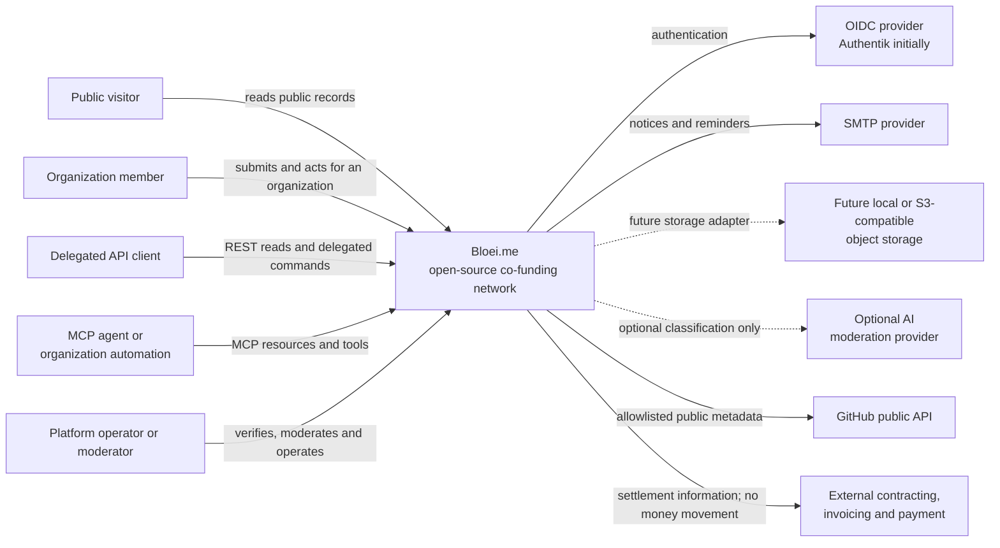
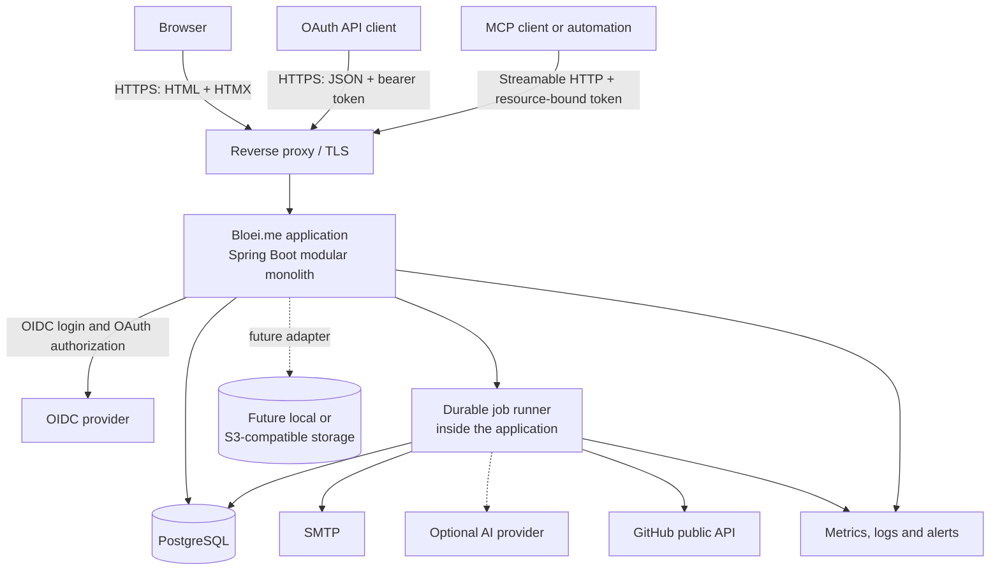
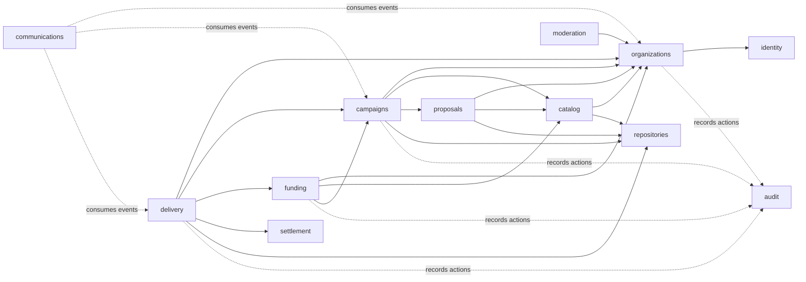
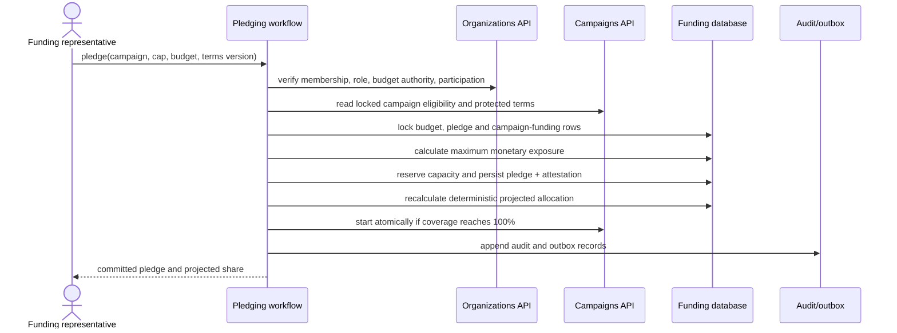
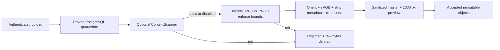
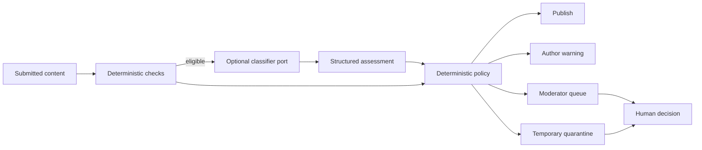

# Bloei.me solution architecture

Status: Proposed architecture

Last updated: 2026-08-21

This document translates the accepted functional design into a buildable
software architecture. It should be read with the
[product plan](plan.md), [decision register](decisions.md),
[scenarios](scenarios.md), and [open questions](open-questions.md).

The architecture makes accepted decisions concrete. Choices that still require
product, operational, or legal agreement remain explicitly provisional and are
linked to the open-question register rather than silently becoming product
policy.

## 1. Architecture objectives

Bloei.me must provide:

1. **Dependable financial coordination.** Budget reservations, pledge changes,
   campaign starts, final allocations, and budget consumption must remain
   correct under concurrency, retries, delayed jobs, and personnel changes.
2. **Auditable organizational action.** Public commitments belong to verified
   organizations, while the system retains protected evidence of the person,
   authority, terms, and policy involved at the time of action.
3. **Stable campaign governance.** Versioned terms, explicit state transitions,
   orthogonal holds, amendments, review, objections, and settlement must be
   reproducible from stored facts.
4. **Public transparency with deliberate privacy.** Public projections expose
   organizational funding history without leaking budgets, cost centers,
   personal actors, verification evidence, or moderation casework.
5. **Operational simplicity.** One deployable application and one primary
   database should support the pilot without distributed-system complexity.
6. **Safe evolution.** Module boundaries must accommodate multiple budgets per
   pledge, four-eyes authorization, external contracts, optional AI moderation,
   programs, and integrations without putting those features in v1.

## 2. Architecture principles

- Use a **modular monolith** with one process, one PostgreSQL database, and
  explicit in-process module APIs.
- Organize code around **business capabilities**, not technical layers.
- Keep write models private to their owning module. Other modules use commands,
  queries, or published events rather than accessing tables directly.
- Use ordinary relational state as the source of truth. Add append-only audit
  and outbox records; do not use event sourcing for v1.
- Keep financially coupled changes in one database transaction. Use events for
  consequences, not for invariants that must succeed atomically.
- Make time, money, percentage rounding, identity snapshots, terms versions,
  and authorization results explicit domain values.
- Treat public pages and exports as deliberate projections, never as generic
  serialization of internal entities.
- Prefer server-rendered, progressively enhanced interactions. A usable core
  journey must not depend on client-side application state.
- Keep external systems behind ports owned by the module that needs the
  capability.

## 3. System context



Bloei.me coordinates commitments and outcomes. It does not hold funds, name the
recipient of a contribution, issue invoices, divide supplier revenue, or sign
external agreements in v1.

It supports only its own funding workflow. Component support, bugs, feature
requests, and vulnerability reports link to maintainer-owned systems and are
not proxied into Bloei.me service obligations.

## 4. Runtime containers



The web application and durable workflows run from one artifact and one process
in v1. The deployment uses one stable DBOS executor identity and does not run
overlapping application replicas until active-active recovery is designed.

## 5. Technology baseline

| Concern | Baseline |
| --- | --- |
| Language and runtime | Kotlin on JVM 25 |
| Application framework | Spring Boot 4 |
| Module enforcement | Spring Modulith |
| Web | Spring MVC, Thymeleaf, HTMX, local CSS and minimal JavaScript |
| Public API | Planned as a later same-process interface; not part of the initial scaffold |
| Agent automation | Streamable HTTP MCP in the same application, added with the first domain slices |
| Authentication | Spring Security OAuth2/OIDC client and OAuth resource server |
| Database | PostgreSQL |
| SQL access | Exposed JDBC SQL DSL; no Exposed DAO |
| Schema changes | Flyway forward migrations |
| Object evidence | PostgreSQL `bytea` through a multi-backend storage port |
| Durable workflows | DBOS Transact using the application PostgreSQL instance |
| Email | SMTP through a notification port |
| Packaging | One OCI image; Compose reference deployment |
| Localization | Dutch and English message bundles |
| Testing | JUnit 5, property tests, Testcontainers, browser and accessibility tests |

Library and infrastructure versions should be pinned centrally and upgraded as
an explicit maintenance task. The architecture does not depend on a specific
cloud provider.

### 5.1 Persistence-library decision

D-068 selects the Exposed JDBC SQL DSL and supersedes the jOOQ part of D-030.

| Criterion | Exposed SQL DSL | jOOQ |
| --- | --- | --- |
| Kotlin ergonomics | Kotlin-native table and query DSL | Works well from Kotlin but exposes a Java-oriented API |
| Schema typing | Table definitions are maintained in Kotlin | Database schema generates strongly typed sources |
| Build workflow | No code-generation database step | Code generation adds excellent drift detection but more build setup |
| PostgreSQL concurrency | Supports `FOR UPDATE` variants and `SKIP LOCKED` | Extensive locking and PostgreSQL SQL support |
| Advanced SQL | Covers the expected v1 queries; custom SQL may need an extension or JDBC | Broader SQL surface and stronger complex-query composition |
| Migrations | Keep Flyway authoritative; do not generate production DDL at runtime | Keep Flyway authoritative; generate types from migrated schema |
| Module ownership | Each module owns its table objects naturally | Each module needs carefully scoped generated-schema outputs |

The baseline is **Exposed SQL DSL, without Exposed DAO**, because
Bloei.me is domain-workflow-heavy rather than reporting-heavy and benefits from
concise Kotlin persistence code. Feature persistence maps rows into domain
values; Exposed table and result types never leave their owning feature. Raw
parameterized JDBC remains an escape hatch when a
PostgreSQL query is not expressed cleanly by the DSL.

Testcontainers integration tests must prove Spring transaction participation,
module schemas, row locking, `SKIP LOCKED`, JSONB, typed IDs, Flyway validation,
and the pledge transaction as these capabilities are implemented. Do not use
Exposed schema creation or migration utilities in production. Feature-owned
persistence and Flyway migrations preserve the option to replace Exposed if
experience provides a concrete reason.

## 6. Business modules

Each top-level feature package is a Spring Modulith application module. Types at
the package root form its initial API; internal subpackages are inaccessible to
other features unless deliberately exposed as a named interface.



An arrow points from the consumer to the API or event type it depends on; it
never permits table access. Public-page composition may query several modules,
including moderation restrictions, without creating business-module cycles.
During implementation, `ApplicationModules.verify()` must fail the build on
cycles or internal-package access.

### 6.1 `identity`

Owns:

- OIDC subject linkage and local person identifier
- display locale and minimal account preferences
- account-link, anonymization, and session-related application policies
- current authenticated actor abstraction

It does not own organization membership or authority. Authentication says who
the person is; `organizations` says on whose behalf they may act.

### 6.2 `organizations`

Owns:

- organization legal identity and versioned public profile
- verification status and protected verification evidence metadata
- platform participation and terms acceptance
- organization memberships and role assignments
- budget-use authorizations
- future generic authorization requests and approvals
- duplicate merge and historical identity snapshots

Its public API answers factual identity, active participation, current
membership, and authority questions. It must never return raw verification
evidence to ordinary business modules.

### 6.3 `catalog`

Owns:

- canonical open-source components, hierarchy, lineage, and relations
- source locations, licence and supported-release metadata
- versioned primary and co-maintainer stewardship
- stewardship claims, confirmation, transfer, and challenge workflow
- future optional non-isolating programs and curation

Programs are disabled in v1 without changing the component model. Verified
organizations privately propose components; operators approve canonical
publication and adjudicate versioned stewardship under D-075.

### 6.4 `proposals`

Owns:

- private idea submissions and curation status
- published proposal versions and component targets
- verified-organization endorsements
- proposal discussion and lifecycle
- supplier-formation invitations and private draft references

Moderation restrictions are overlays; hiding text must not mutate endorsements
or proposal lifecycle facts.

### 6.5 `campaigns`

Owns:

- supplier formation and selection rationale
- lead and co-supplier participation confirmations
- campaign terms and immutable versions
- formal component targets and maintainer confirmations
- maximum and final price constraints
- primary lifecycle, deadlines, pauses, holds, and overdue condition
- clarifications, material amendments, and consent state
- campaign-level conflict information

This module is the authority for whether a campaign may accept a pledge, start,
receive evidence, enter review, or terminate. It does not calculate allocations
or alter budgets.

### 6.6 `funding`

Owns two closely coupled subdomains:

- **Budgets:** envelopes, cost centers, validity, optional component scope,
  immutable ledger, and authorization references.
- **Pledges:** organization-owned pledge lifecycle, versioned attestation,
  one visible budget selection in v1, future allocation rows, cap, reservation,
  and max-min fair allocation.

Keeping these subdomains in one module makes reservation and pledge mutation
atomic while preserving internal package separation. No public query returns
budget or cost-center information outside the owning organization.

### 6.7 `delivery`

Owns:

- progress entries and sanitized delivery evidence
- immutable first evidence submission and final-price declaration
- review windows and notification requirements
- criterion-based objections, supplier responses, and resubmission
- organization ballots, explicit and deemed positions
- negative-consent acceptance calculation
- failed-delivery outcome

The module records organization positions separately from displayed text so a
moderation restriction cannot change a vote or objection state.

### 6.8 `settlement`

Owns:

- frozen final organization contributions
- explicit supplier-contribution lines
- payee-free settlement notes
- lead-supplier completion and exceptional audited reopening
- reproducible CSV and JSON exports

It contains no invoice, tax, bank account, payment, reminder, creditor, or
supplier-revenue-allocation model.

### 6.9 `moderation`

Owns:

- reports and stable references to reported content
- protected cases, decisions, restrictions, notices, appeals, and case events
- deterministic moderation policy
- optional provider-neutral AI assessments and temporary quarantine

It can restrict how content is displayed. It cannot transition a campaign,
change a pledge or ballot, verify an organization, or suspend platform
participation. Those actions remain with their governing modules.

V1 implements no AI provider. The assessment boundary remains designed for a
future advisory-only classifier whose structured output has no tools, domain
commands, or direct restriction authority.

### 6.10 `communications`

Owns:

- in-app notifications
- email templates and delivery attempts
- user language and channel resolution
- reminder scheduling and suppression
- bounce and failure diagnostics

It consumes durable events and never decides whether a deadline passed or an
outcome was accepted. Governing modules make those decisions and ask
communications to notify affected organizations.

### 6.11 `audit`

Owns the tamper-evident application audit stream and authorized audit queries.
Every important command writes an audit fact in the same transaction as the
business change. Audit payloads use a versioned, allowlisted schema and avoid
copying raw sensitive evidence.

### 6.12 `repositories`

Owns:

- provider-neutral canonical code repository identity;
- allowlisted observed metadata and synchronization state;
- canonical URL history and provider-stable external identifiers;
- normalized issues, pull requests, commits, and releases; and
- provider ports, with GitHub as the first read-only implementation.

Catalog, proposal, campaign, and delivery modules own their typed associations
to repository or external-work IDs. Repository observations cannot command
those modules or translate provider state into Bloei.me lifecycle changes.

## 7. Module internals and code organization

A feature starts with only the types it needs. Technical subpackages appear
when the feature gains those concerns; empty layer packages are not created:

```text
nl.bloei.<module>
├── public commands, queries, IDs and events at the feature root
├── model/               optional internal aggregates and policies
├── persistence/         optional feature-owned Exposed tables and queries
├── workflow/            optional concrete DBOS workflows
└── integration/         optional provider-specific clients
```

Do not add ports, repositories, generic base entities, or engine-neutral
workflow facades without an actual replaceable boundary. Shared business
concepts stay with the feature that owns their rules. The `app` project owns UI
composition and runtime configuration; it does not become a second business
layer.

## 8. Domain identity and value handling

- Use opaque typed IDs in Kotlin so organization, component, campaign, pledge,
  and person identifiers cannot be mixed accidentally.
- Generate RFC 9562 UUIDv7 values in the application through a small wrapper
  around pinned `uuid-creator` 6.x, store native PostgreSQL `uuid`, and expose
  aggregate-specific Kotlin inline value classes. Treat stored timestamps and
  event sequence—not the UUID timestamp—as authoritative business time.
- Store money as ISO currency plus signed 64-bit minor units. V1 campaigns use
  EUR, but arithmetic must not assume two decimal places.
- Store percentages as integer basis points. Never use binary floating point
  for caps, thresholds, or monetary allocation.
- Store instants as `timestamptz` and the immutable campaign timezone as an IANA
  zone name. Derive deadlines once and retain both the local policy input and
  authoritative instant.
- Snapshot organization legal name and identifying facts on commitments and
  settlements while retaining a link to the canonical organization.
- Version campaign terms, pledge attestations, policies, templates, moderation
  assessments, and public export schemas.

## 9. Command, query, and event model

### Commands

Commands express one authorized intention, for example:

- `RegisterOrganization`
- `VerifyOrganizationIdentity`
- `CreateBudget`
- `PublishCampaign`
- `PlaceOrChangePledge`
- `StartCampaignEarly`
- `ProposeCampaignAmendment`
- `SubmitDeliveryEvidence`
- `MaintainObjection`
- `CastOrganizationBallot`
- `CompleteSettlementNote`

A command handler:

1. resolves the authenticated person and represented organization;
2. obtains a request id for idempotency where a retry could duplicate work;
3. loads authoritative state inside a transaction;
4. evaluates authorization and domain policy;
5. locks the minimal contested records in deterministic order;
6. changes owned state and records the audit fact;
7. writes outbox messages for asynchronous consequences; and
8. commits before presenting success.

### Queries

Use separate query services and projections for:

- public pages;
- signed-in organization workspaces;
- operator and moderator casework; and
- versioned exports.

Query models can join or denormalize public data for performance, but protected
views must start from an explicit audience and allowlist. Do not expose a
generic entity endpoint or automatic object mapper.

### Events

There are two event classes:

- **Transactional domain notifications** coordinate code within the current
  process only when the whole operation still shares one transaction.
- **Durable integration events** are stored in the outbox and delivered at
  least once to jobs, notifications, and future external integrations.

Consumers must be idempotent. An outbox event is not proof that email arrived;
delivery attempts and results are separate records.

## 10. Critical transactional workflows

### 10.1 Place or change a pledge



The funding workflow is the transaction coordinator. It uses public module APIs
but one Spring transaction and one database connection. Notification delivery
occurs after commit.

### 10.2 Submit delivery

In one transaction, the delivery workflow:

1. verifies the lead supplier and campaign eligibility;
2. validates the final price is between zero and the immutable maximum;
3. creates an immutable evidence version referencing already-sanitized objects;
4. permanently closes pledging;
5. freezes the funder set and deterministic final allocation;
6. releases reservation surplus while retaining final reserved amounts;
7. opens the review window from an authoritative instant; and
8. records audit and notification events.

Object upload and sanitization occurs before this transaction in a quarantined
staging area. Only a validated object reference can be attached to evidence.

### 10.3 Accept delivery and create settlement

The acceptance command locks the campaign review, objections, ballots, funding
allocation, and relevant budget ledger rows in deterministic order. It rechecks
the authoritative deadline and negative-consent rule, then atomically:

- records acceptance and every explicit or deemed organization position;
- consumes final budget amounts and releases remaining reservations;
- creates frozen contribution and supplier-contribution lines;
- creates one open, payee-free settlement note per funding organization; and
- emits acceptance and settlement notifications.

No asynchronous consumer may perform the financial state transition.

## 11. Concurrency and consistency

- Use a numeric optimistic version for aggregates that users edit over several
  screens, including campaign drafts and organization profiles.
- Use `SELECT ... FOR UPDATE` for scarce financial capacity and terminal
  workflow transitions.
- Acquire locks in a documented order: campaign, organization IDs sorted,
  budget IDs sorted, pledge IDs sorted, then review or settlement rows.
- Enforce invariants with database constraints as well as application rules:
  non-negative capacity, one effective organization pledge per campaign,
  exactly one lead supplier, unique active stewardship where required, and one
  terminal campaign outcome.
- Use request-level idempotency keys for financial and terminal commands.
- Evaluate deadline commands against the database transaction time and stored
  instants. Background jobs are prompts to evaluate state, not the source of
  truth.
- Persist rounding remainder allocation and its deterministic tie-break order
  so the same input always produces the same cents.

## 12. Persistence design

Use one PostgreSQL database with a schema per business module where practical:

```text
identity.*       organizations.*       catalog.*
repositories.*   proposals.*           campaigns.*
funding.*        delivery.*            settlement.*
moderation.*     communications.*       audit.*
platform.*
```

Rules:

- Only a module repository reads or writes its schema.
- Cross-module references store stable IDs but avoid cross-schema cascade
  deletion. Business records are closed, merged, anonymized, or tombstoned.
- Foreign keys may protect foundational identity references where ownership and
  migration order are unambiguous; module APIs still remain the application
  boundary.
- Ledger, audit, case-event, attestation, terms-version, ballot-history, and
  outbox tables are append-only to ordinary application roles.
- Organizations, components, proposals, campaigns, and future programs receive
  an immutable canonical slug at publication or launch. It is lowercase ASCII
  kebab-case, at most 80 characters, unique within its resource type, and uses
  deterministic numeric collision suffixes. Old slugs are never reassigned;
  later editing requires permanent redirect history as part of the same change.
- JSONB is reserved for versioned evidence metadata, policy inputs, audit
  payloads, and provider responses. Core searchable state remains relational.
- Flyway migrations are forward-only in deployed environments. Destructive
  transformations use expand/migrate/contract releases with backup validation.

Database row-level security is not required for v1 because the application is
the only database client and module-specific queries use explicit audience
projections. This is a proposed implementation choice, not permission to weaken
application authorization. Reconsider RLS if direct analytics or external data
access is introduced.

## 13. Authorization architecture

Authorization combines role-based and attribute-based checks:

```text
allow = authenticated person
    AND active organization membership
    AND required organization or object-scoped role
    AND active platform participation where required
    AND budget authorization for financial actions
    AND satisfied internal approval policy
    AND no supplier/funder conflict
    AND target object permits the action in its current state
```

- MVC controllers perform coarse access checks and call application commands.
- Command handlers always repeat authoritative authorization; controllers are
  not a security boundary.
- Every decision returns a stable policy reason suitable for audit and safe user
  feedback.
- Public URLs never imply public access to related internal records.
- Platform operator and moderator privileges are distinct authorities.
- Exceptional operations require a reason, audit event, notice policy, and
  preferably a second operator for high-impact actions once staffing permits.
- Future four-eyes support wraps a command in a generic authorization request;
  v1 executes an eligible request immediately with one approver.

## 14. Web and interaction architecture

- Use semantic server-rendered HTML as the default response.
- Use HTMX for partial form submission, validation, filters, modal workflows,
  and live fragments; every action retains a normal HTTP fallback.
- Use Post/Redirect/Get for successful state changes.
- Protect all state-changing requests with CSRF tokens and same-site cookies.
- Use accessible status summaries and field errors; do not rely on color,
  animation, hover, or toast messages alone.
- Render Dutch and English from message bundles. Persist user-authored content
  in its authored language and label it rather than silently translating it.
- Store authored prose as versioned restricted Markdown. A constrained
  WYSIWYG editor may use ProseMirror internally but persists only Markdown and
  exposes only losslessly serializable constructs. Raw HTML is disabled.
- Render Markdown to semantic HTML and plain text on the JVM, apply the final
  HTML allowlist, and treat generated output as a disposable versioned
  projection. Publication-sensitive workflows show the authoritative server
  preview; public output remains usable without JavaScript.
- Keep business semantics in versioned domain records rather than custom
  Markdown syntax. Managed inline images reference only sanitized Bloei.me
  media associated with the current content revision and require alt text.
- Maintain a small local design system of templates, CSS tokens, forms, tables,
  timelines, status badges, callouts, and audit views.
- Avoid exposing internal IDs, exceptions, policy details, or personal actor
  data in HTML fragments and browser logs.

The interactive [functional design](index.html) (https://bloei.me) communicates the
product model but is not itself the production UI implementation.

### 14.1 Local and automated login

Authentication is an adapter behind the `identity` module's authenticated-actor
boundary. Production uses OIDC; local development and browser tests may use a
separate `dev-auth` adapter.

The deployment accepts one OIDC issuer. A person is identified by the exact
`(issuer, subject)` pair; email is display/contact data and never an automatic
account-linking key. Organization membership and every Bloei.me role remain
local authority. The identity provider is the first recovery path, followed by
an audited organization-control recovery process when provider recovery cannot
restore access. A one-use bootstrap configuration names the first operator by
exact issuer and subject. Platform roles and high-impact organization actions
require MFA or recent step-up assurance, with the decision recorded in audit.

The development adapter:

- lives in a separate Gradle module or source set that is absent from the
  production runtime classpath and OCI image;
- exposes a local persona chooser with seeded people, organizations, roles,
  verification states, and conflict cases;
- creates an ordinary application session through the same authenticated-actor
  boundary used by OIDC;
- shows a persistent, visually prominent development-authentication banner;
- marks audit actors as local fixtures and never accepts arbitrary identity,
  organization, or role input from request headers;
- starts only with an explicit local configuration and disposable development
  data; and
- is used by browser tests, while lower-level security tests use Spring
  Security test support directly.

CI also runs an OIDC contract journey against a controlled test provider or
protocol stub. A separate optional Compose profile may run Authentik for a
production-like smoke test. The convenient local path must not become the only
tested authentication path.

### 14.2 REST, MCP, and event interfaces

REST will be a separate same-process interface over core commands and
audience-aware queries. It is deliberately not scaffolded with the initial web
application. When added, it publishes no generic entity store and does not make
HTTP calls back into the same application. The source-controlled OpenAPI 3.1 contract, OAuth
scopes, ETag policy, idempotency behavior, problem codes, public/private
projections, and cursor feeds are normative in
[api-and-integrations.md](api-and-integrations.md).

Public REST controllers expose anonymous read projections. Delegated controllers
validate an Authentik token intended for `bloei-api`, then pass the authenticated
person, explicit acting organization, OAuth client, scopes, versions, and
request metadata into the same command handlers used by HTML forms. Platform-
operator and moderator decision controllers remain outside the public API
adapter and OpenAPI document.

MCP is an early same-process adapter at `/mcp`, not a REST proxy or separate
service. It publishes protected resource discovery, explicit audience-aware
resources and read tools, and narrow write tools mapped one-to-one to
application commands. The first complete tool journey covers campaign
formation and management through progress, evidence, final price, and delivery
submission. Closed JSON Schemas, explicit acting organization, current domain
authorization, optimistic versions, idempotency, confirmations, rate limits,
and audit apply at the adapter and command boundary.

Interactive MCP uses delegated-person authorization code with PKCE. Unattended
MCP uses an expiring organization automation principal with named campaign and
delivery capabilities and optional component/campaign restrictions. It cannot
hold platform or human administration powers. High-impact interactive actions
require a short-lived server confirmation token; an explicitly scoped
automation grant can authorize unattended campaign publication or delivery
submission, which is labelled and audited as automated. Binary media continues
through the authenticated quarantine/upload flow rather than tool-embedded
base64 or arbitrary URL fetching.

An event-feed projection consumes allowlisted durable events. It exposes a
90-day, at-least-once public feed and an audience-filtered authorized feed using
opaque cursors. It is not the audit log or a state-reconstruction mechanism.

## 15. Evidence and object-storage pipeline



- Accept only static JPEG and PNG identified from decoded bytes. Reject WebP,
  GIF, SVG, AVIF, APNG, multiple frames, malformed input, and disguised types.
- Limit each evidence revision to 20 images and each image to 15 MiB, 24
  megapixels, and 8192 pixels on either axis. Require meaningful alt text.
- Use Java ImageIO with pinned TwelveMonkeys 3.14.x JPEG support. Apply
  orientation, normalize sRGB, strip all metadata, and re-encode in the same
  format. Produce a sanitized full-resolution master and a 1600-pixel
  longest-edge preview.
- Run processing asynchronously with DBOS and explicit `quarantined`,
  `processing`, `accepted`, and `rejected` states. Evidence cannot be submitted
  while any referenced image is unfinished.
- Store v1 raw and sanitized bytes as PostgreSQL `bytea` behind the storage
  port. Assign application object IDs, record SHA-256, backend, decoded media
  type, dimensions, byte size, sanitizer version, uploader organization, and
  retention class. Do not deduplicate objects by checksum.
- The generic `ContentScanner` port is optional, with ClamAV as its first
  adapter. If configured scanning is unavailable, processing fails closed and
  the upload stays quarantined.
- Quarantine has no delivery route. Stable `/media/{objectId}` routes authorize
  private content and serve public immutable previews with correct MIME,
  `X-Content-Type-Options: nosniff`, dimensions, lazy loading, and long-lived
  caching; the sanitized master may be opened separately.
- Delete raw successful and rejected uploads immediately at terminal processing
  and abandoned upload chunks after 24 hours. PDFs remain unsupported pending a
  separate validation, rendering, and content-disarm decision.
- The port records a backend per object and permits one write adapter plus
  multiple read adapters. Future local-filesystem and S3-compatible migrations
  copy, checksum-verify, atomically switch the reference, wait a grace period,
  then delete the old copy.

## 16. Jobs and notifications

A PostgreSQL job table supports scheduled evaluation. Workers claim due rows
with `FOR UPDATE SKIP LOCKED`, record a lease, and retry with bounded backoff.
Dead-letter state raises an operational alert rather than silently abandoning
work.

Jobs include:

- funding and delivery deadline evaluation;
- budget-expiry warnings;
- review and contested-vote reminders;
- automatic acceptance evaluation;
- paused-window resumption;
- outbox delivery;
- notification rendering and SMTP delivery;
- evidence cleanup; and
- retention tasks once policy is accepted; and
- repository metadata validation, scheduled refresh, and bounded retry.

Every job is safe to run more than once. A delayed job reads current state and
the authoritative deadline before acting. Notices keep channel, template
version, audience organization, recipient resolution, attempts, and outcome.

## 17. Moderation and AI boundary

Deterministic checks run first: length, type, malware result, rate limits,
required fields, and known unsafe markup. The optional classifier receives only
the minimum content and context needed for a versioned assessment.



The provider has no database credentials, browser tools, domain command port,
or ability to follow instructions embedded in submitted text. Store structured
assessment output and provider/model/policy versions, not hidden reasoning. AI
failure must degrade to deterministic rules and human queues. V1 leaves this
port unimplemented under D-076.

## 18. Security and privacy controls

Before pilot launch:

- threat-model identity takeover, unauthorized representation, budget
  overcommit, supplier/funder conflicts, deadline manipulation, stored XSS,
  malicious images, object enumeration, privilege escalation, and audit
  tampering;
- use secure, HTTP-only, same-site cookies; session rotation; short inactivity
  limits for privileged work; and explicit logout;
- set CSP, HSTS, frame restrictions, MIME-sniffing prevention, referrer policy,
  and restrictive permissions policy;
- parse versioned restricted Markdown with raw HTML disabled, validate links
  and managed media references, and sanitize the disposable rendered HTML with
  an allowlist;
- rate-limit login callbacks, invitations, submissions, comments, reports,
  uploads, API clients, event feeds, repository refresh, and notification-
  producing actions;
- encrypt transport everywhere and storage through platform-managed keys;
- keep application, migration, backup, and read-only operational database roles
  separate;
- never put verification evidence, personal actors, cost centers, or AI input in
  ordinary logs;
- validate API token audience and scopes, prohibit cookie authentication on API
  writes, and allow protected browser CORS only for registered client origins;
- construct repository-provider calls from parsed allowlisted identifiers and
  never fetch a submitted hostname or follow a redirect outside that provider;
- make secrets runtime configuration, never image or repository content;
- scan dependencies and the OCI image, produce an SBOM, and sign release images;
  and
- test restore procedures, not only backup creation.

D-078 supplies the reviewable pilot retention schedule and working privacy-role
allocation. The hosted operator is controller for core purposes; participating
organizations are independent controllers for their own purposes; instructed
vendors are processors; and self-hosted operators assume deployment-level
responsibility. Public history, audit, identity, authority, moderation, logs,
incidents, notifications, idempotency, uploads, and backups each use their
category-specific period from [legal.md](legal.md). Lawful bases, final periods,
DSA, AI Act, and controller/processor conclusions remain subject to Q-015,
Q-016, and specialist review.

## 19. Observability and operations

### Health

- Liveness covers process health only.
- Readiness verifies database and required configuration; optional AI does not
  make the service unready.
- A separate protected diagnostic view reports SMTP, object storage, job queue,
  outbox age, migration, and backup status.

### Metrics

At minimum:

- HTTP latency and errors by normalized route;
- authentication and authorization failures without personal labels;
- database pool and transaction metrics;
- job queue depth, oldest due job, retries, and dead letters;
- outbox age and notification delivery results;
- evidence validation failures and storage latency;
- REST request outcomes, event-feed lag, idempotency conflicts, and OAuth
  failures by safe bounded category;
- repository refresh age, provider outcomes, rate limits, and stale records;
- campaign transition counts and deadline correction events; and
- AI assessment latency, failure, override, and quarantine rates when enabled.

Do not use organization, person, campaign, repository, or content identifiers
as unbounded metric labels.

### Logs and tracing

Use structured logs with request, command, and trace correlation IDs. Log stable
error codes and object types, with identifiers only where the operational
purpose and access policy allow them. Distributed tracing can remain optional
for a single process but trace context should propagate through jobs and outbox
delivery.

## 20. Deployment topology

### Pilot

```text
Internet
   │
TLS reverse proxy
   │
Bloei.me application ─── PostgreSQL
   ├──────────────────── Authentik / OIDC
   └──────────────────── SMTP
```

The reference Compose deployment provides the application and PostgreSQL;
evidence bytes are included in PostgreSQL backup and recovery. OIDC and SMTP
stay configurable external dependencies. A future local-filesystem adapter is
limited to explicit single-node/self-hosted configurations. A future
S3-compatible adapter supports hosted or replicated deployments; neither is a
v1 runtime dependency.

One application replica is sufficient initially; the job design must already
be safe with multiple replicas.

### Production readiness

- immutable signed OCI image and declarative configuration;
- reverse proxy with TLS and request-size limits;
- managed or operator-owned PostgreSQL with point-in-time recovery;
- tested database media backup and recovery, with checksum-verified object
  migration before any later storage backend becomes authoritative;
- encrypted backups with documented recovery point and time objectives;
- rolling deployment compatible with expand/migrate/contract database changes;
- separate staging environment with synthetic organizations and no copied
  production evidence; and
- operator runbooks for identity outage, SMTP failure, storage failure,
  migration failure, queue backlog, security incident, and verified platform
  outage correction.

Hosted protected data stays in the EU/EEA. The pilot targets RPO one hour and
RTO eight hours. Concrete providers and service ownership remain deployment
configuration and depend on the hosted operator in Q-018.

## 21. Testing architecture

### Module tests

- Pure domain tests cover value objects, state machines, policies, conflict
  rules, deadlines, and authorization decisions.
- Property tests cover water-filling, rounding, caps, ordering independence,
  negative consent, and time-window boundaries.
- Spring Modulith verification tests enforce module structure and document
  published events.

### Integration tests

- Testcontainers starts the supported PostgreSQL version for Exposed repository,
  Flyway migration, locking, and transaction tests.
- Concurrency tests race pledges, cap changes, deadline jobs, amendments,
  evidence submission, acceptance, and role revocation.
- Contract tests cover OIDC claims, SMTP messages, object storage, exports, and
  the optional AI assessment schema.
- OpenAPI tests cover representations, RFC 9457 problems, OAuth scopes, ETags,
  idempotency, public/private projections, and command parity with the web
  adapter.
- MCP contract tests cover discovery, protocol negotiation, resource and tool
  schemas, delegated and automation OAuth, capability and object scope,
  confirmation tokens, immediate revocation, idempotency, bounded results, and
  parity with the same application commands.
- Repository-provider tests cover URL parsing, SSRF attempts, GitHub rename,
  archive, rate limit, deletion, timeout, malformed responses, credential
  redaction, and provider-state isolation.
- Event-feed tests cover ordering, at-least-once duplicates, visibility,
  revocation, cursor expiry, and authoritative resynchronization.
- Migration tests upgrade a representative previous database and verify
  rollback through deployment recovery, not down migrations.

### End-to-end tests

Automated browser journeys run in Dutch and English for:

- organization registration, verification, roles, and representative change;
- budget creation and authorization;
- proposal and supplier formation;
- pledging through automatic and early start;
- scope amendment and failed consent;
- delivery, ordinary review, objection, voting, and resubmission;
- settlement export and lead-only completion; and
- report, restriction, tombstone, appeal, and AI-disabled operation.

Run automated accessibility checks plus keyboard and screen-reader-oriented
manual review at critical milestones.

## 22. Proposed repository structure

```text
.
├── modules/
│   └── core/                    business features, persistence and workflows
├── apps/
│   └── app/                     Boot runtime and server-rendered web UI
├── deploy/                      optional local service configuration
├── .github/workflows/           verification and security gates
├── compose.yaml                 local app and PostgreSQL, optional profiles
├── build.gradle.kts
├── settings.gradle.kts
└── gradle/libs.versions.toml
```

Only `modules/core` and `apps/app` are production Gradle projects. Spring
Modulith verifies feature-package boundaries inside `modules/core`. REST and
MCP interfaces are libraries loaded into the same application when their first
slice is implemented; neither requires a new Gradle project or process.

## 23. Delivery slices

Build vertical, demonstrable slices rather than completing every technical
layer first.

1. **Executable foundation**
   - Gradle/JVM/Spring baseline, licence, formatting, CI, module verification,
     PostgreSQL migration, bilingual page shell,
     security headers, and health.
2. **Identity-to-organization slice**
   - OIDC login, provisional organization, membership, verification case,
     activation, public profile, protected operator view, organization
     automation registration, MCP OAuth/discovery foundation, and audit trail.
3. **Component-to-proposal slice**
   - Canonical component, stewardship assignment, private idea, curation,
     repository linking, GitHub public metadata, public API projections,
     proposal, endorsement, and moderation overlay.
4. **Budget-to-pledge slice**
   - Private budget and ledger, authorization, publishable campaign fixture,
     pledge cap, reservation, fair-share projection, and concurrent-capacity
     tests.
5. **Formation-to-start slice**
   - Supplier eligibility, lead/co-supplier confirmation, campaign terms,
     component targets, publication, deadlines, full-coverage and early start,
     with matching campaign MCP resources and write tools.
6. **Amendment slice**
   - Protected term versions, provisional reservation changes, unanimous
     explicit consent, timeout, failure, and audit display.
7. **Evidence-to-acceptance slice**
   - Sanitized evidence, final price, pledge freeze, notices, review,
     objections, responses, negative-consent voting, acceptance, and the MCP
     progress/evidence/delivery automation journey.
8. **Settlement-to-pilot slice**
   - Budget consumption, contribution lines, payee-free notes, exports,
     lead-completed status, observability, recovery test, and pilot hardening.

Each slice ends with module tests, PostgreSQL integration tests, an accessible
browser journey, migration verification, local formatting, changelog update,
and a Conventional Commit. MCP contract tests join with its identity foundation
and expand with every exposed domain slice; REST tests join when REST is added.

## 24. Architecture decision backlog

Q-036 requires an Authentik-backed spike before the MCP identity foundation:
prove stable person identity across web and MCP clients, Protected Resource
Metadata and resource indicators, practical client onboarding, organization
automation provisioning and rotation, and immediate application-level
revocation. The MCP product boundary is accepted; this spike selects a correct
reference OAuth configuration and compatible Spring libraries.

The UUIDv7, slug, identity, Markdown/WYSIWYG, MCP product surface, evidence-
image, and PostgreSQL-first storage rules are accepted implementation
constraints. Their acceptance checks still apply when each feature is built.

## 25. Readiness gates before coding

The application foundation can begin once these launch-affecting questions have
an explicit temporary or final answer:

- Q-008: assign the two named operating contacts and protected rota;
- Q-015 and Q-016: initial retention and privacy-role working policies;
- Q-018: hosted operator.

Not every item requires a permanent policy before the first code commit. A
documented pilot default is sufficient where it does not misrepresent legal
certainty or create an irreversible data model.
